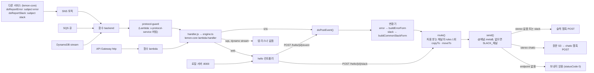

# lemon-hello-api

LemonCloud의 hello 서비스 대표 샘플이다(프로필 `none`·`lemon`).
플랫폼 서비스의 에러 리포트와 슬랙 알림을 받아 슬랙과 DoU(chatic) 채팅방으로 보낸다.
`v5` 브랜치는 형제 저장소 `eureka-hello-api`의 `v5`와 코드가 같다. 다른 것은 이름과 배포 프로필뿐이다.
lemon-core 서비스는 처리하지 않은 예외를 SNS로 보낸다. 이 서비스의 `backend` 함수가 그 SNS를 받는다.
채널 설정의 `rules`가 목적지를 고른다. 채널의 `stereo`가 보내는 형식을 정한다.
이 README는 사람과 AI 에이전트의 단일 진입점이다. 모든 내용은 저장소 파일 기준이다. 문서와 소스가 다르면 소스가 맞다.

## 한눈에 보기

| 항목 | 값 |
|---|---|
| 런타임 | Node `24.15.0`(`.nvmrc`), `engines.node` `>=24.0.0`. pack은 `nodejs24.x`(`pack.config.json`)를 만든다. dev 함수는 이관 뒤 `nodejs24.x`다. prod는 `serverless.yml` `provider.runtime`(env 설정)이다. |
| 언어·빌드 | TypeScript `^4.7.4`. `ttsc`(ttypescript)로 `src/` → `dist/`. `ts-transformer-keys`가 모델 필드 목록(`keys<T>()`)을 만든다. |
| 테스트 | jest `^29.7.0` + ts-jest `^29.4.15`(`src/**/*.spec.ts`, ttypescript 컴파일). Lambda 도구(`lemon-*`)의 테스트는 lemon-core에 있다. |
| 프레임워크 | `lemon-core` `^5.0.23`(설치판 5.0.23). lemon-model은 lemon-core를 통해 온다. 루트 이름은 `lemon-core`, 그 밖은 `lemon-core/model`에서 가져온다. `lemon-model`·`@types/*` 모델 패키지는 직접 선언하지 않는다. |
| 로컬 서버 | lemon-core `buildExpress()`의 로컬 API Gateway(`src/express.ts`). `serverless.yml` 라우트를 따른다. 없는 경로·메서드는 `403`이다. 앞단 내장 앱이 `POST /echo`를 받는다. `express`·`lemon-devkit`은 쓰지 않는다. |
| AWS SDK | v3(`@aws-sdk/*` `^3.1159.0`). lemon-core v5의 선택 peer 8개를 `dependencies`에 둔다. `client-cloudwatch-logs`는 devDependency다(`lambda:logs`). |
| overrides | `deepmerge` → `scripts/deepmerge-safe/`(dev 전용 대체본), `minimatch` `^11.0.4`, `test-exclude` `^7.0.2`(그 안의 `glob` `^14.0.2`). |
| 배포 | Serverless Framework는 설치하지 않는다. `sls` 스크립트도 없다([docs/serverless.md](docs/serverless.md)). dev는 2026-10-31 배포 서비스로 이관됐다. 이제 코드만 배포한다(`deploy:dev`·`lambda:deploy:dev`). prod는 아직 Serverless 스택(`lemon-hello-api-prod`)이다. |
| 리소스 이름 | `serverless.yml` `custom:`의 이름을 유지한다: 테이블 `LemonHelloTest`(local·dev)·`LemonHelloTable`(prod), 큐 `lemon-hello-sqs(-dev)`, 토픽 `lemon-hello-sns(-dev)`, 버킷 기본값 `lemon-hello-www`. |
| 브랜치 | 기본 브랜치 `develop`. v5 라인은 `v5`이고 `develop`으로 PR #73이 열려 있다. lemon dev는 2026-10-31부터 v5 코드로 돈다. |
| 버전·라이선스 | `package.json` `version` `5.26.1030`. MIT([LICENSE](LICENSE)). |

## 저장소 지도

| 경로 | 내용 | 누가 고치나 |
|---|---|---|
| `handler.js` | Lambda 진입점. `dist/index`의 `engine()`을 export 한다. | 거의 안 고침 |
| `src/index.ts` | `engine()`·`express()` 로더. 직접 실행하면 로컬 서버를 띄운다. | 거의 안 고침 |
| `src/engine.ts` | lemon-core 엔진. 웹 컨트롤러 `hello`와 ALB 핸들러를 등록한다. SNS·SQS 핸들러에 `protocol-guard`를 건다. | 기능 추가 시 |
| `src/express.ts` | 로컬 서버(lemon-core 로컬 API Gateway) + `POST /echo` | 거의 안 고침 |
| `src/api/hello-api.ts` | `/hello` 컨트롤러. 생성자가 SNS 리스너 `doPostEvent()`를 등록한다. | 개발자 |
| `src/service/hello-service.ts` | `HelloService`. 채널 저장소(`test` 레코드 `@<채널>`의 `meta$`), `SlackService`, SQS·SNS 발신. `assertLocalOnly()`·`assertNotReserved()` | 개발자 |
| `src/service/slack-service.ts` | 분류(`route()`·`match()`), 발송(`send()`·`postMessage()`), SNS subject별 변환기 | 개발자 |
| `src/service/chatic-transformer.ts` | 슬랙 메시지 → chatic 웹훅 본문 `{ content, stereo: 'webhook', token, meta }`. 순수 함수 | 개발자 |
| `src/service/slack-types.ts` | `SlackChannelModel`, `ChannelStereo`, `RouteRule`, `ChaticWebhookMeta` | 개발자 |
| `src/service/channel-policy.ts` | `endpoint` 허용 호스트, `rules` 패턴 검사·컴파일 | 개발자 |
| `src/service/protocol-guard.ts` | Lambda에서 SNS·SQS protocol 메시지를 버리는 래퍼 | 사람 검토 필수 |
| `src/service/log-mask.ts` | 로그 전용 마스킹 `maskSecrets()`. 던지지 않는다. JSON 문자열 안도 마스킹한다. | 개발자 |
| `src/service/hello-model.ts` | `TestModel`과 필드 목록 `$FIELD` | 개발자 |
| `bin/deploy-dev.sh` | `deploy:dev` 래퍼(pack → 계획 → `--apply` → 점검). dev만 받는다. | 사람 검토 필수 |
| `scripts/deepmerge-safe/` | 개발 전용 `deepmerge` 대체본(`overrides`, jest 29의 `jest-config`용). 고친 판이 나오면 지운다. | 거의 안 고침 |
| `pack.config.json` | `lemon-lambda-pack` 설정(소스 허용 목록, 런타임 경로, `handler.lambda`) | 개발자 |
| `*.config.example.json` | `deploy`(code 모드)·`deploy.dev`·`migration` 예시. 값은 자리표시자다. 실제 설정은 `.artifacts/`(git 무시)에만 둔다. | 사람 검토 필수 |
| `data/` | 더미 데이터(`dummy-table.yml`)와 로고. Lambda 패키지에 들어간다. | 개발자 |
| `sample/` | SNS 메시지 예시(`error-1.json`, `slack-1.json`) | 참고용 |
| `serverless.yml` | 함수·이벤트·IAM·리소스. 로컬 서버가 `http` 이벤트로 라우트를 만든다. `sls`로는 쓰지 않는다. | 사람 검토 필수 |
| `swagger/documentation.yml` | 옛 `serverless-aws-documentation` 설정. 기록이다. | 거의 안 고침 |
| `env/` | 프로필 설정(`none.yml`, `lemon.yml`), `config.js`, `settings.yml` | **에이전트는 열지 않음** |
| `dist/`, `coverage/`, `.artifacts/` | 빌드·커버리지·pack 출력과 실제 설정(git 무시) | 손으로 고치지 않음 |

## 요청 흐름



- 두 함수 모두 `handler.lambda`를 쓴다. 함수별 이벤트는 `serverless.yml` `functions:`에 있다.
- 에러 리포트(subject `error`)는 채널 `public`으로 들어간다. `public`의 `rules`가 `moveTo`·`copyTo`로 전달 채널을 고른다.
- subject `slack`은 `slack/<채널>` 또는 본문 `channel`의 채널로 들어간다. 채널이 없으면 `public`이다.
- 규칙은 처음 받는 채널의 것만 한 번 적용한다. 전달받은 채널의 `rules`는 다시 돌지 않는다.
- 채널 설정은 `test` 레코드 `@<채널>`의 `meta$`에 있다. `endpoint`가 없으면 env `SLACK_<채널>`로 보낸다. 모든 발송의 부모는 `public`이다.
- chatic 채널은 본문에 `token`을 싣는다. 대상 채팅방은 `endpoint`의 `channelId` 쿼리다. 원문 S3 저장은 채널 `useS3`, 없으면 env `SLACK_PUT_S3`(기본 `1`)를 따른다. 버킷 키는 `MY_S3_BUCKET`이다.
- 발송 실패는 throw 하지 않는다. 결과의 `statusCode: 500`과 로그 `err.send:<채널>` 줄에만 남는다. SNS 리스너가 실패해도 재시도는 없다.
- env `REPORT_ERROR`(기본 `1`)가 켜져 있으면 lemon-core가 이 서비스의 에러를 SNS로 보낸다. 구독을 더한 계정은 이 값을 꺼야 루프가 생기지 않는다.
- 내부 호출(protocol)은 lemon-core relay로 간다. 이 서비스는 `x-protocol-context`를 읽지 않는다.
- Lambda에서 SNS·SQS의 protocol 메시지는 lemon-core에 닿기 전에 버린다. 경고 한 줄(`drop protocol message`)만 남고 SQS도 다시 오지 않는다. 로컬 모드에서는 웹 컨트롤러로 간다. 이유는 [보안 리뷰](docs/security-review-2026-10-30.md)의 H-2다.
- 발송은 `https:`일 때만 한다. `http:`와 URL 안의 계정 정보는 거부한다(`statusCode: 400`, `400 INVALID ENDPOINT`).
- 허용 호스트는 `hooks.slack.com`과 env `CHANNEL_ENDPOINT_HOSTS`(쉼표 목록)다. 이 키가 있으면 목록 밖으로 보내지 않는다. 없으면 보내되 경고 한 줄(`endpoint host not in allow-list`, 호스트만)을 남긴다.
- 웹훅 POST는 10초 뒤 끊는다(`504 TIMEOUT`).

**HTTP 라우트** (`serverless.yml` 명시 라우트, `src/api/hello-api.ts`)

| 메서드·경로 | 핸들러 | 인증 |
|---|---|---|
| `GET /` | 서비스 이름·버전 | 없음 |
| `GET /hello`, `GET /hello/{id}` | `doList`, `doGet`(메모리 샘플, 최대 100개) | 없음 |
| `POST /hello/subscribe` | 메모리 샘플 추가. `name`은 200자에서 자른다. 100개가 차면 가장 오래된 것을 지운다. | 없음 |
| `GET /hello/{id}/channel` | 채널 설정 읽기. 로컬 모드가 아니면 `endpoint` 앞 12자, `token` 끝 4자만 보인다. `meta$`는 빠진다. | 없음 |
| `GET /hello/{id}/dynamo` | DynamoDB 읽기. **로컬 모드만**. 그 밖에는 `404`. | 없음 |
| `POST /hello/{id}/slack` | 슬랙 메시지 발송. `id`가 채널이다. `0`이면 본문 `channel`, 그다음 `public`이다. | `aws_iam` |
| `POST /hello/{id}/event` | SNS 경로와 같은 변환·발송(`?subject=`) | `aws_iam` |
| `POST /hello/{id}/channel` | 채널 설정 병합 저장. `channel: ''`이면 삭제. 응답은 읽기와 같이 마스킹. `endpoint`는 허용 호스트만 받는다(키가 없으면 그 채널에 저장된 호스트도). `rules` 패턴은 200자 이하·컴파일 성공만(`400`). | `aws_iam` |
| `POST /hello/{id}/dynamo`, `/sqs`, `/sns` | DynamoDB 쓰기, SQS·SNS protocol 발신. **로컬 모드만**. 그 밖에는 `404`. | `aws_iam` |
| `POST /hello/{id}/echo` | 요청 echo | `aws_iam` |
| `PUT /hello/{id}` | 메모리 샘플의 `name`만 바꾼다(200자). | `aws_iam` |
| `DELETE /hello/{id}` | 메모리 샘플 삭제 | `aws_iam` |
| `/{type}/{id}/{cmd}` 일반 라우트 | 다른 type | `aws_iam` |

- `@`로 시작하는 `id`는 예약 레코드(채널 설정)다. `dynamo`·`channel`·`slack` 라우트는 이 `id`에 `404`를 준다.
- 로컬 모드(`$U.isLocalMode()`)는 `LOCAL_MODE=1`이고 `AWS_LAMBDA_FUNCTION_NAME`이 없을 때다. 요청의 `domain`은 권한을 주지 않는다.
- 로컬 서버도 `serverless.yml`에 없는 경로·메서드에 `403 {"message":"Missing Authentication Token"}`을 준다. 명시 라우트(`/hello…`)가 일반 라우트(`/{type}…`)를 가린다.

## 기능을 어디에 넣나

- **새 발송 형식**: `slack-types.ts` `ChannelStereo`에 값을 더하고 `slack-service.ts` `send()`에 분기를 둔다. 변환은 순수 함수 파일로 둔다(예: `chatic-transformer.ts`). 대상 호스트는 env `CHANNEL_ENDPOINT_HOSTS`에 사람이 더한다.
- **새 SNS subject**: `slack-service.ts` `asTransformer()`와 `$transformer`에 더한다.
- **새 라우트**: `hello-api.ts`에 `do<Method><Cmd>` 핸들러를 더한다. 인증 없는 경로는 `serverless.yml`에 명시 라우트로 둔다. 저장소 레코드를 돌려주는 시험용 라우트는 `assertLocalOnly()`로 막는다. 요청 `id`로 저장소를 읽으면 `assertNotReserved()`를 부른다.
- **새 env 키**: 코드는 `$U.env('<KEY>')`로 읽는다. 값은 사람이 `env/` 파일에 넣는다.
- 동작을 바꾸면 spec을 먼저 고친다. SNS 경로 계약은 `src/api/hello-api-event.spec.ts`에 있다.

## 명령

`package.json` scripts 21개를 모두 적는다. `!`로 시작하는 키 6개는 구분선 주석이다.

| 명령 | 하는 일 | 주의 |
|---|---|---|
| `nvm use` | `.nvmrc`의 Node로 맞춘다 | scripts 아님 |
| `npm ci` | 의존성 설치 | `package-lock.json` 사용 |
| `npm run build` | `build-ts` → `ttsc` → `dist/` | |
| `npm test` | `LS=1 jest` | AWS를 부르지 않는다. 배포 API E2E는 `ENV=<프로필>`과 자격 증명이 있을 때만 돈다. |
| `npx tsc --noEmit` | 타입 검사만 | scripts 아님. 파일을 쓰지 않는다. lint 스크립트는 없다. |
| `npm run express` | `ENV=none STAGE=local LOCAL_MODE=1 LOCAL_TRANSPORT=mock`로 `start` | 포트는 `package.json` `port`(8000). 이 서비스로 가는 SNS·SQS·protocol 발신은 프로세스 안에서 전달한다. 다른 대상은 `501`. 슬랙·chatic POST는 실제로 나간다. |
| `npm run express.aws` | `LOCAL_TRANSPORT` 없이 같은 실행 | 발신이 실제 AWS로 간다 |
| `npm run fields:types` | `lemon-fields-types`. `$FIELD` 필드 타입 충돌 검사 | AWS·서버 불필요 |
| `npm run lambda:invoke -- ...` | 배포된 함수 호출(`lemon-lambda-invoke`) | [docs/lambda-tools.md](docs/lambda-tools.md) |
| `npm run lambda:logs -- ...` | CloudWatch 로그 조회·추적(`lemon-lambda-logs`) | SNS 알림 로그는 `--fn backend` |
| `npm run perf:lambda -- ...` | 반복 호출, cold/warm 요약(`lemon-lambda-perf`) | |
| `npm run lambda:pack` | Docker에서 검증된 Lambda ZIP을 `.artifacts/lambda/`에 만든다(`lemon-lambda-pack`) | AWS 불필요. `scripts/deepmerge-safe/`는 ZIP에 들어가지 않는다. [pack](docs/lambda-tools.md#pack-and-offline-deploy-plan) |
| `npm run lambda:deploy -- --config <파일> --artifact <pack 출력>` | pack 출력 검증 + 오프라인 배포 계획(`lemon-lambda-deploy`, `code` 모드) | AWS 불필요. `bootstrap` 모드 금지 |
| `npm run lambda:migrate -- <단계> --config <파일>` | dev Serverless 스택 이관(`lemon-lambda-migrate`). 기본은 오프라인 계획 | dev는 이관 끝. 다시 돌리지 않는다. [docs/lambda-migrate.md](docs/lambda-migrate.md) |
| `npm run lambda:deploy:dev -- --config <파일> --artifact <pack 출력>` | 이관된 dev 함수 2개에 코드만 배포(`lemon-lambda-deploy-dev`). 기본은 오프라인 계획 | `--apply`는 사람만 |
| `npm run deploy:dev` | `bin/deploy-dev.sh`: pack → 계획 → `lambda:deploy --apply` → GET `/`·`/hello/0`. 기본 `dev`·`profile=lemon`, 설정 `.artifacts/deploy.code.dev.json` | 사람만. `--plan-only`면 계획까지. [수동 dev 배포](docs/lambda-tools.md#manual-dev-deploy-bindeploy-devsh) |

내부용(직접 부를 일 없음): `build-ts`·`watch-ts`·`nodemon`·`start`(`build` 뒤 `watch-ts`+`nodemon` 동시 실행, `express`가 부름), `*start`(`*`로 꺼 둔 ts-node 실행), `test:watch`·`test.local`(jest 변형), `plato`(`dist` 복잡도 보고서 → `complexity/`. `plato`는 devDependencies에 없다).

**사람만 실행** — 에이전트는 사람이 명시적으로 시킬 때만 돌린다.

| 명령 | 스테이지 |
|---|---|
| `deploy:dev`(`--plan-only` 없이) | dev |
| `lambda:deploy:dev -- ... --apply` | dev |
| `lambda:deploy -- ... --apply` | `deploy:dev` 안에서 dev `code` 모드로만. 직접 쓰지 않는다. |
| `lambda:migrate -- <단계> ... --execute` | dev(2026-10-31 끝남. 다시 돌리지 않는다) |
| prod 배포(`npx serverless@3.40.0`, [docs/serverless.md](docs/serverless.md)) | **prod**(이관 전) |

- 설정의 `account`·`profile`이 대상 계정을 정한다. 도구는 실행 전에 STS로 계정을 확인한다.
- dev 이관의 `verify`는 exit 3(`unknown`, 로그 보존 기간 차이)으로 멈췄다. receipt lock은 그대로 둔다. lock을 지우거나 단계를 다시 돌리지 않는다([결과](docs/lambda-migrate.md#dev-migration-result-2026-10-31)).
- prod를 v5로 옮기기 전에 채널 설정을 옮긴다. v5는 옛 `channel`·`target` 레코드를 읽지 않는다. `@<채널>`만 읽는다. 그동안 `SLACK_<채널>` 폴백이 발송을 잇는다. `rules`·`stereo`·`token`은 폴백되지 않는다([절차](docs/lambda-migrate.md#channel-settings-migration-before-prod)).
- `CHANNEL_ENDPOINT_HOSTS` 없이 배포해도 chatic 발송은 멈추지 않는다. 배포 뒤 `backend` 로그의 `endpoint host not in allow-list` 줄로 호스트를 확인하고, 사람이 스테이지별 env에 넣기를 권한다.

## 작업 검증

완료라고 말하기 전에 아래를 돌린다. 기대값은 2026-11-03 이 브랜치에서 잰 수치다.

```sh
npm ci                  # 기대: exit 0
npx tsc --noEmit        # 기대: 출력 없음, exit 0
npm test                # 기대: Test Suites 7 passed, Tests 55 passed, exit 0 (약 4초)
npm run build           # 기대: exit 0
```

- 테스트가 실패하면 테스트가 아니라 코드를 고친다.
- SNS 경로(`doPostEvent`, `slack-service`, `chatic-transformer`)의 계약은 `src/api/hello-api-event.spec.ts`와 `src/service/slack-service.spec.ts`다.
- 보안 동작의 계약은 `protocol-guard.spec.ts`(H-2), `channel-policy.spec.ts`(H-1·L-2), `log-mask.spec.ts`(L-4), `hello-api.spec.ts`(C-1·L-3)다.
- 테스트 endpoint는 `https://` 테스트 호스트다. spec이 `CHANNEL_ENDPOINT_HOSTS`를 바꾸고 되돌린다.
- 로컬 서버는 시작할 때 설정을 복호화(KMS)하므로 AWS를 쓸 수 있다. 서버는 사람이 띄운다. 자격 증명이 없으면 AWS를 쓰는 라우트(`dynamo` 등)만 실패한다.

배포 뒤 점검(사람이 dev에 배포한 뒤, dev만):

```sh
npm run lambda:invoke -- --stage dev --profile <name> --path /hello/0   # 기대: function-error=none, http 200
npm run lambda:logs -- --stage dev --profile <name> --fn backend --since 5m --filter '"sent["'   # 발송 결과 줄
npm run perf:lambda -- --stage dev --profile <name> --runs 5            # cold/warm 시간
```

- `lambda:invoke`는 `http 4xx/5xx`여도 exit 0이다. 출력의 `http` 줄을 본다.
- 발송 확인은 `backend` 로그의 `sent[` 줄이 200인지 본다. 500이면 `err.send:<채널>` 줄을 본다.

## 에이전트 규칙

- `env/*.yml`·`env/config.js`를 열지 않는다. 값을 출력·인용하지 않는다. env는 키 이름(`CHANNEL_ENDPOINT_HOSTS`, `SLACK_<채널>`, `SLACK_PUT_S3`, `MY_S3_BUCKET`, `REPORT_ERROR`)으로만 말한다.
- 채널 `endpoint`·`token`, 웹훅 주소, 계정 번호, ARN, 호스트를 코드·문서·로그·PR에 쓰지 않는다. `CHANNEL_ENDPOINT_HOSTS` 값도 사람이 env 파일에서 고친다.
- `@<채널>`은 예약 레코드다. 요청 `id`로 이 레코드를 읽거나 쓰는 경로를 만들지 않는다. 채널 설정은 `channel` 라우트로만 다룬다.
- `GET /hello/{id}/channel` 응답을 로컬 모드로 받아 붙이지 않는다. 로컬 모드는 마스킹을 끈다.
- 로그에는 `log-mask.ts` `maskSecrets()`를 거친 값만 찍는다. 그 결과는 로그 전용이다. 보낼 데이터로 쓰지 않는다.
- `isLocalMode()`는 로컬 편의 스위치다. 권한이 아니다. 이 서비스에는 관리자 게이트가 없다. 관리자만 부를 라우트를 만들면 lemon-core `hasAdminRole()`로 막는다. `isLocalMode()`나 요청 `domain`으로 대신하지 않는다.
- `protocol-guard`를 빼거나 `serverless.yml` IAM에 `lambda:InvokeFunction`을 다시 넣지 않는다. 사람 결정이 필요하다.
- 이 서비스에 `bootstrap` 모드를 쓰지 않는다. 테이블 이름이 lemon 규칙 밖이라 새 빈 테이블이 생기고 채널 설정이 두 테이블로 갈라진다.
- `--execute`·`--apply`·`deploy:dev`는 사람이 명시적으로 시킬 때만 돌린다. 실제 설정은 `.artifacts/`에만 두고 커밋하지 않는다.
- prod 스테이지를 호출하지 않는다. lemon-core 도구는 dev 외 스테이지에 `--confirm-stage <stage>`를 요구한다. 이 플래그는 사람의 명시 지시가 있을 때만 붙인다.
- `lambda:*`·`perf:lambda`에 `--raw`를 쓰지 않는다. 계정·ARN·토큰 마스킹이 꺼진다. `--fn backend --event sns`는 실제 채널로 보낸다. 먼저 `--dry`로 확인한다.
- `sls`·`serverless`를 devDependencies에 다시 넣지 않는다. 필요하면 [docs/serverless.md](docs/serverless.md)의 `npx` 구성을 쓴다.
- `dist/`·`coverage/`·`.artifacts/`는 생성물이다. 손으로 고치지 않는다. `scripts/deepmerge-safe/`와 `overrides`는 사람 결정 없이 바꾸지 않는다.
- 작업 전에 브랜치를 만든다. v5 라인 작업의 base는 `v5`다.

## 문서 색인

| 문서 | 내용 |
|---|---|
| [docs/lambda-tools.md](docs/lambda-tools.md) | `lemon-*` 스크립트 표, `deploy:dev`, 함수·계정, AWS SDK 패키지, pack·오프라인 계획, 예시. 옵션·exit code는 lemon-core `docs/v5/B19-bin-tools.md`·`B19-bin-deploy.md` |
| [docs/lambda-migrate.md](docs/lambda-migrate.md) | dev 이관 6단계, bootstrap 금지, dev 코드 배포, 오프라인 점검, dev 이관 결과(2026-10-31), prod 전 채널 설정 이행 |
| [docs/serverless.md](docs/serverless.md) | Serverless Framework를 지운 기록, 남긴 파일, 스테이지별 상태, `npx` 구성, 지운 스크립트 대응표 |
| [docs/security-review-2026-10-30.md](docs/security-review-2026-10-30.md) | 2026-10-30 보안 리뷰 결과표(C-1·H-1·H-2·L-1~L-6), 변경, 검증, 남은 결정 |
| [LICENSE](LICENSE) | MIT |
| [lemon-core HOW_TO_UPGRADE_V5.md](https://github.com/lemoncloud-io/lemon-core/blob/v5/HOW_TO_UPGRADE_V5.md) | lemon-core v4 → v5 업그레이드 가이드 |

----------------

## VERSION INFO

| Version   | Description
|--         |--
| 5.26.1030 | (v5) `lemon-core@^5.0.23`, Node 24. Serverless Framework removed; dev migrated to the deploy service (2026-10-31), `deploy:dev`. 2026-10-30 security review fixes; log masking never throws (PR #73). same code as `eureka-hello-api`, profiles `none`·`lemon`.
| 0.24.511  | optimized with `lemon-core#3.2.15`.
| 0.24.1127 | initial version with `lemon-core#3.2.10`.
