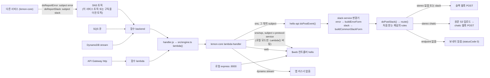

# lemon-hello-api

플랫폼 서비스의 에러 리포트와 슬랙 알림을 받아 슬랙과 DoU(chatic) 채팅방으로 보내는 서비스다.
lemon-core 서비스는 처리하지 않은 예외를 SNS로 보낸다. 이 서비스의 `backend` 함수가 그 SNS를 받는다.
채널 설정의 `rules`가 목적지를 고른다. 채널의 `stereo`가 보내는 형식을 정한다.
이 README는 사람과 AI 에이전트의 진입점이다. 경로·명령·검증·금지 사항을 실제 파일 기준으로 적는다.

## 한눈에 보기

| 항목 | 값 |
|---|---|
| 런타임 | Node `24.15.0` (`.nvmrc`), `engines.node` `>=24.0.0`. Lambda 런타임은 `serverless.yml` `provider.runtime`이 env 설정에서 읽는다. |
| 언어·빌드 | TypeScript `^4.7.4`, `ttsc`(ttypescript)로 `src/` → `dist/`. `ts-transformer-keys` 변환기가 모델 필드 목록을 만든다. |
| 테스트 | jest `^27.5.1` + ts-jest (`src/**/*.spec.ts`). `bin/`은 `node:test` |
| 프레임워크 | `lemon-core` `^5.0.11`. lemon-model은 lemon-core를 통해 온다. 루트 이름은 `lemon-core`, 그 밖의 이름은 `lemon-core/model`에서 가져온다. 이 서비스는 `lemon-model`을 직접 선언하지 않는다. 로컬 express는 `lemon-devkit` `^0.2.2`가 만든다. |
| AWS SDK | v3 (`@aws-sdk/*` `^3.1159.0`). lemon-core v5의 선택 peer 8개를 `dependencies`에 둔다. DynamoDB 클라이언트는 lemon-core에 들어 있다. |
| 배포 | Serverless Framework v3 (`frameworkVersion: "3"`) → AWS Lambda. 계정마다 배포한다(기본, `ssocio`, `muzly`, `epyt`). |
| 브랜치 | 기본 브랜치 `develop`. v5 라인은 `v5` 브랜치에 있다. |
| 패키지 버전 | `package.json` `version` |

## 저장소 지도

| 경로 | 내용 | 누가 고치나 |
|---|---|---|
| `handler.js` | Lambda 진입점. `dist/index`의 `engine()`을 export 한다. | 거의 안 고침 |
| `src/index.ts` | `engine()`·`express()` 로더. 직접 실행하면 express 서버를 띄운다. | 거의 안 고침 |
| `src/engine.ts` | lemon-core 엔진. 웹 컨트롤러 `hello`와 ALB 핸들러를 등록한다. SNS·SQS 핸들러에 `protocol-guard`를 건다. | 기능 추가 시 |
| `src/express.ts` | 로컬 express 서버. `POST /echo`를 더한다. | 거의 안 고침 |
| `src/api/hello-api.ts` | `/hello` 컨트롤러. 생성자가 SNS 리스너 `doPostEvent()`를 등록한다. | 개발자 |
| `src/service/hello-service.ts` | `HelloService`. 채널 저장소(DynamoDB)와 `SlackService`를 묶는다. SQS·SNS 발신(`$protocol`)도 여기에 있다. | 개발자 |
| `src/service/slack-service.ts` | 분류(`route()`·`match()`), 발송(`send()`·`postMessage()`), SNS 제목별 변환기 | 개발자 |
| `src/service/chatic-transformer.ts` | 슬랙 메시지 → chatic 웹훅 본문 `{ content, stereo: 'webhook', token, meta }` 변환. 순수 함수다. | 개발자 |
| `src/service/slack-types.ts` | 채널 설정 `SlackChannelModel`, `RouteRule`, `ChaticWebhookMeta` | 개발자 |
| `src/service/channel-policy.ts` | 채널 `endpoint` 허용 호스트, `rules` 패턴 검사·컴파일 | 개발자 |
| `src/service/protocol-guard.ts` | Lambda에서 SNS·SQS protocol 메시지를 버리는 래퍼 | 사람 검토 필수 |
| `src/service/log-mask.ts` | 로그용 마스킹(`token`, `endpoint`, 비밀 헤더) | 개발자 |
| `src/service/hello-model.ts` | `TestModel`과 필드 목록 `$FIELD` | 개발자 |
| `bin/` | 배포된 Lambda 호출·로그·성능 점검 스크립트 | 개발자 |
| `data/` | 더미 데이터(`dummy-table.yml`). Lambda 패키지에 들어간다. | 개발자 |
| `sample/` | SNS 메시지 예시(`error-1.json`, `slack-1.json`) | 참고용 |
| `swagger/documentation.yml` | `serverless-aws-documentation` 설정 | 개발자 |
| `serverless.yml` | 함수·이벤트·IAM·리소스(DynamoDB 테이블, SQS 큐, SNS 토픽, S3 버킷) | 사람 검토 필수 |
| `env/` | 프로필·스테이지 설정 | **에이전트는 열지 않음** |

## 요청 흐름



- 두 함수 모두 `handler.lambda`를 쓴다. 함수별 이벤트는 `serverless.yml` `functions:`에 있다.
- 에러 리포트(subject `error`)는 채널 `public`으로 들어간다. `public`의 `rules`가 `moveTo`·`copyTo`로 전달 채널을 고른다.
- subject `slack`은 `slack/<채널>` 또는 본문 `channel`의 채널로 들어간다. 채널이 없으면 `public`이다.
- 규칙은 처음 받는 채널의 것만 한 번 적용한다.
- chatic 채널은 본문에 `token`을 싣는다. 대상 채팅방은 `endpoint`의 `channelId` 쿼리다.
- 발송 실패는 throw 하지 않는다. 결과의 `statusCode: 500`과 로그 `err.send:<채널>` 줄에만 남는다.
- SNS 리스너가 실패해도 lemon-core SNS 핸들러는 reject 하지 않는다(v5). 실패는 보고된다. 재시도는 없다.
- `REPORT_ERROR`가 켜져 있으면 lemon-core가 이 서비스의 에러를 SNS로 보낸다. 구독을 더한 계정은 이 값을 꺼야 루프가 생기지 않는다.
- 내부 호출(protocol)은 lemon-core relay로 간다(v5 B14). 이 서비스는 `x-protocol-context`를 읽지 않는다.
- Lambda에서 SNS·SQS의 protocol 메시지(subject `x-protocol-service`)는 lemon-core에 닿기 전에 버린다. 경고 로그 한 줄(`drop protocol message`)만 남는다. SQS는 실패로 세지 않는다. 그래서 다시 오지 않는다. 로컬 모드에서는 그대로 처리한다. 이유는 [보안 리뷰](docs/security-review-2026-10-30.md)의 H-2다.
- 발송은 `https:`일 때만 한다. `http:`와 URL 안의 계정 정보는 항상 거부한다. 결과는 `statusCode: 400`, `400 INVALID ENDPOINT`다.
- 허용 호스트는 `hooks.slack.com`과 env `CHANNEL_ENDPOINT_HOSTS`(쉼표 목록)다.
- `CHANNEL_ENDPOINT_HOSTS`가 있으면 목록 밖 호스트로 보내지 않는다(전체 적용).
- `CHANNEL_ENDPOINT_HOSTS`가 없으면 목록 밖 `https:` 호스트로도 보낸다. 대신 경고 로그 한 줄(`endpoint host not in allow-list`)을 남긴다. 로그에는 호스트만 있다.
- 웹훅 POST는 10초 뒤 끊는다(`504 TIMEOUT`).

**HTTP 라우트** (`serverless.yml` 명시 라우트)

| 메서드·경로 | 핸들러 | 인증 |
|---|---|---|
| `GET /` | 서비스 이름·버전 | 없음 |
| `GET /hello`, `GET /hello/{id}` | `doList`, `doGet` (메모리 샘플. 최대 100개) | 없음 |
| `POST /hello/subscribe` | 메모리 샘플 추가. `name`은 200자에서 자른다. 100개가 차면 가장 오래된 것을 지운다. | 없음 |
| `GET /hello/{id}/channel` | 채널 설정 읽기. 로컬 모드가 아니면 `endpoint`는 앞 12자, `token`은 끝 4자만 보인다. | 없음 |
| `GET /hello/{id}/dynamo` | DynamoDB 읽기. **로컬 모드만.** 그 밖에는 `404`다. | 없음 |
| `POST /hello/{id}/slack` | 슬랙 메시지 발송. `id`가 채널이다. `0`이면 본문 `channel`, 그다음 `public`이다. | `aws_iam` |
| `POST /hello/{id}/event` | SNS 경로와 같은 변환·발송(`?subject=`) | `aws_iam` |
| `POST /hello/{id}/channel` | 채널 설정 병합 저장. `channel: ''`이면 삭제한다. 응답도 읽기와 같이 마스킹한다. `endpoint`는 허용 호스트만 받는다. `CHANNEL_ENDPOINT_HOSTS`가 없으면 그 채널에 저장된 endpoint와 같은 호스트도 받는다. `rules` 패턴은 200자 이하·정규식 컴파일 성공만 받는다(`400`). | `aws_iam` |
| `POST /hello/{id}/dynamo`, `/sqs`, `/sns` | DynamoDB 쓰기, SQS·SNS protocol 발신. **로컬 모드만.** 그 밖에는 `404`다. | `aws_iam` |
| `POST /hello/{id}/echo` | 요청 echo | `aws_iam` |
| `PUT /hello/{id}` | 메모리 샘플의 `name`만 바꾼다(200자에서 자름). | `aws_iam` |
| `DELETE /hello/{id}` | 메모리 샘플 삭제 | `aws_iam` |
| `/{type}/{id}/{cmd}` 일반 라우트 | 다른 type | `aws_iam` |

- `dynamo`·`sqs`·`sns`는 로컬 모드(`$U.isLocalMode()`)에서만 돈다. `sqs`·`sns`의 본문 `service`는 그때 쓴다.
- `@`로 시작하는 `id`는 예약 레코드(채널 설정)다. `dynamo`·`channel`·`slack` 라우트는 이 `id`에 `404`를 준다.
- 로컬 모드는 `LOCAL_MODE=1`이고 `AWS_LAMBDA_FUNCTION_NAME`이 없을 때다. 요청의 `domain`은 권한을 주지 않는다(v5).

## 기능을 어디에 넣나

- **새 발송 형식이면** `slack-types.ts`의 `ChannelStereo`에 값을 더한다. `slack-service.ts` `send()`에 분기를 둔다. 변환은 순수 함수 파일로 둔다. 예시는 `chatic-transformer.ts`다. 대상 호스트는 env `CHANNEL_ENDPOINT_HOSTS`에 더해야 보낸다.
- **새 SNS subject면** `slack-service.ts`의 `asTransformer()`와 `$transformer`에 더한다.
- **새 라우트면** `hello-api.ts`에 `do<Method><Cmd>` 핸들러를 더한다. 인증 없는 경로가 필요하면 `serverless.yml`에 명시 라우트를 둔다. 저장소 레코드를 돌려주는 시험용 라우트는 `assertLocalOnly()`로 막는다. 요청 `id`로 저장소를 읽으면 `assertNotReserved()`를 부른다.
- 동작을 바꾸면 spec을 먼저 고친다. SNS 경로 계약은 `src/api/hello-api-event.spec.ts`에 있다.

## 명령

| 명령 | 하는 일 | 주의 |
|---|---|---|
| `nvm use` | `.nvmrc`의 Node로 맞춘다 | |
| `npm ci` | 의존성 설치 | `package-lock.json` 사용 |
| `npm run build` | `ttsc` → `dist/` | |
| `npm test` | `LS=1 jest` | 커버리지는 `coverage/`. AWS를 부르지 않는다. 배포 API E2E는 `ENV=<프로필>`과 자격 증명이 있을 때만 돈다. |
| `npx tsc --noEmit` | 타입 검사만 | 파일을 쓰지 않는다 |
| `npm run lint` | `tsc --noEmit` + `eslint --fix` | **파일을 고쳐 쓴다** |
| `npm run express` | `ENV=none STAGE=local LOCAL_MODE=1 LOCAL_TRANSPORT=mock`로 빌드·watch·nodemon 실행 | 포트는 `package.json` `port`(8000). 이 서비스로 가는 SNS·SQS·protocol 발신(`/hello/0/sqs`·`/sns`)을 프로세스 안에서 전달한다. 다른 대상은 `501`이다. 슬랙·chatic 웹훅 POST는 실제로 나간다. |
| `npm run express.aws` | `ENV=none STAGE=local LOCAL_MODE=1`로 실행 | 발신이 실제 AWS로 간다 |
| `npm run lambda:test` | `bin/lib/*.test.mjs` 오프라인 테스트 | AWS·서버 불필요 |
| `npm run lambda:invoke -- ...` | 배포된 함수 호출 | [bin/README.md](bin/README.md#lambdainvoke) |
| `npm run lambda:logs -- ...` | CloudWatch 로그 조회·추적 | [bin/README.md](bin/README.md#lambdalogs). SNS 알림 로그는 `--fn backend` |
| `npm run perf:lambda -- ...` | 반복 호출, cold/warm 시간 요약 | [bin/README.md](bin/README.md#perflambda) |

**사람만 실행** — 에이전트는 사람이 명시적으로 시킬 때만 돌린다.

| 계정 | 명령 | 스테이지 |
|---|---|---|
| 기본(`profile=none`) | `deploy` / `deploy.prod`, `pack` / `pack.prod`, `info` / `info.prod`, `logs` / `logs.prod`, `remove` / `remove.prod` | dev / prod |
| `ssocio` | `deploy.ssocio`, `pack.ssocio`, `info.ssocio`, `logs.ssocio`, `remove.ssocio` | prod |
| `muzly` | `deploy.muzly` / `deploy.muzly.prod`, `pack.muzly`, `info.muzly`, `logs.muzly`, `remove.muzly` | dev / prod |
| `epyt` | `deploy.epyt` / `deploy.epyt.prod`, `pack.epyt`, `info.epyt`, `logs.epyt`, `remove.epyt` | dev / prod. `pack`·`info`·`logs`·`remove`는 prod다. |

- `ssocio`·`muzly`·`epyt` 명령은 `--aws-profile`을 명시한다. 다른 계정으로 잘못 가지 않게 하려는 것이다.
- 2026-10-30 보안 변경은 `CHANNEL_ENDPOINT_HOSTS` 없이 배포해도 chatic 발송을 멈추지 않는다. 목록 밖 호스트는 경고 로그만 남긴다.
- 배포 뒤 env 파일의 스테이지마다 `CHANNEL_ENDPOINT_HOSTS`(chatic 웹훅 호스트, 쉼표 목록)를 넣기를 권한다. 넣으면 허용 목록이 전체 적용된다. 먼저 `backend` 로그에서 `endpoint host not in allow-list` 줄의 호스트를 확인한다.
- `remove.*`는 스택을 지운다. 채널 설정이 든 DynamoDB 테이블도 지워진다.
- `logs.*`는 `logs.ssocio`만 `-f backend`다. 나머지는 `-f lambda`다. SNS로 들어온 알림은 `backend` 함수 로그에 있다.

## 작업 검증

완료라고 말하기 전에 아래를 돌린다.

```sh
npx tsc --noEmit        # 기대: 출력 없음, exit 0
npm test                # 기대: jest 요약에 failed 0, exit 0
npm run lambda:test     # bin/ 을 바꿨을 때. 기대: fail 0
npm run build           # 기대: exit 0
```

- 테스트가 실패하면 테스트가 아니라 코드를 고친다.
- `AWS_PROFILE`이 없는 프로필을 가리키면 express 테스트 `GET /hello/0`이 실패한다. lemon-devkit express가 요청마다 프로필 자격 증명을 읽기 때문이다. 환경 문제다.
- SNS 경로(`doPostEvent`, `slack-service`, `chatic-transformer`)를 바꾸면 `src/api/hello-api-event.spec.ts`와 `src/service/slack-service.spec.ts`가 계약이다.
- 보안 동작의 계약은 `src/service/protocol-guard.spec.ts`(H-2), `src/service/channel-policy.spec.ts`(H-1·L-2), `src/service/log-mask.spec.ts`(L-4), `src/api/hello-api.spec.ts`(C-1·L-3)다.
- 테스트 endpoint는 `https://` 테스트 호스트다. spec이 `CHANNEL_ENDPOINT_HOSTS`를 테스트 호스트로 바꾸고 되돌린다.
- 로컬 서버는 시작할 때 설정을 복호화(KMS)하므로 AWS를 쓸 수 있다. 서버는 사람이 띄운다.

배포 후 점검(사람이 dev에 배포한 뒤, dev 스테이지만):

```sh
npm run lambda:invoke -- --stage dev --profile <name> --path /hello/0   # 기대: function-error=none, http 200
npm run lambda:logs -- --stage dev --profile <name> --fn backend --since 5m --filter '"sent["'   # 발송 결과 줄
npm run perf:lambda -- --stage dev --profile <name> --runs 5            # cold/warm 시간
```

- `lambda:invoke`는 `http 4xx/5xx`여도 exit 0이다. 출력의 `http` 줄을 본다.
- 발송 확인은 `backend` 로그의 `sent[` 줄이 200인지 본다. 500이면 `err.send:<채널>` 줄을 본다.

## 에이전트 규칙

- `env/*.yml`·`env/config.js`를 열지 않는다. 그 값을 출력·인용하지 않는다.
- 채널 설정의 `endpoint`·`token`, 웹훅 주소, 계정 번호, ARN을 코드·문서·로그·PR에 쓰지 않는다.
- `GET /hello/{id}/channel` 응답을 로컬 모드로 받아 붙이지 않는다. 로컬 모드는 마스킹을 끈다.
- `CHANNEL_ENDPOINT_HOSTS` 값은 env 파일에 있다. 사람이 고친다. 에이전트는 그 호스트를 코드·문서에 쓰지 않는다.
- 로그에 `token`·전체 `endpoint`·`authorization`·`cookie`·`x-lemon-identity`를 찍지 않는다. `log-mask.ts`의 `maskSecrets()`를 쓴다.
- `protocol-guard`를 빼거나 `serverless.yml` IAM에 `lambda:InvokeFunction`을 다시 넣지 않는다. 사람 결정이 필요하다.
- `bin/` 스크립트에 `--raw`를 쓰지 않는다. 계정·ARN·토큰 마스킹이 꺼진다.
- `--fn backend --event sns`는 실제 슬랙·DoU 채널로 보낸다. 먼저 `--dry`로 확인한다.
- deploy·pack·info·`sls logs`·remove는 사람이 명시적으로 시킬 때만 돌린다.
- prod 스테이지 호출은 하지 않는다. `bin/`의 stage guard는 dev 외 스테이지에 `--confirm-stage <stage>`를 요구한다. 이 플래그는 사람의 명시 지시가 있을 때만 붙인다.
- 작업 전에 브랜치를 만든다. v5 라인 작업의 base는 `v5`다.
- `npm run lint`는 파일을 고쳐 쓴다. 의도한 경우에만 돌린다.
- 문서와 소스가 다르면 소스가 맞다.

## 문서 색인

| 문서 | 내용 |
|---|---|
| [bin/README.md](bin/README.md) | `lambda:invoke`·`lambda:logs`·`perf:lambda` 옵션, 계정·자격 증명, 안전 규칙, exit code |
| [docs/security-review-2026-10-30.md](docs/security-review-2026-10-30.md) | 2026-10-30 보안 리뷰 결과표, 이번 변경, 검증, 남은 결정 |
| [lemon-core HOW_TO_UPGRADE_V5.md](https://github.com/lemoncloud-io/lemon-core/blob/v5/HOW_TO_UPGRADE_V5.md) | lemon-core v4 → v5 업그레이드 가이드 |

## LICENSE

[MIT](http://opensource.org/licenses/MIT)

----------------

## VERSION INFO

| Version   | Description
|--         |--
| (v5)      | migrated to `lemon-core@^5.0.11` and Node 24 (`v5` branch). local mode by `LOCAL_MODE=1`, `bin/` harness.
| 0.24.511  | optimized with `lemon-core#3.2.15`.
| 0.24.1127 | initial version with `lemon-core#3.2.10`.
